

<picture>
  <source media="(prefers-color-scheme: dark)" srcset="assets/banner-dark.svg">
  
</picture>

  

## 👋 About me

Software engineer with **5 years** of building cloud-native, distributed systems. I work mostly in **.NET** and **Angular** on **Azure** and **Kubernetes**: low-latency microservices, event-driven architectures and, more recently, **LLM and RAG** applications.

- 🏢 **Software Engineer @ Gantner** (Dec 2024 – present): real-time hardware-to-cloud pipelines with gRPC and SignalR, service mesh tuning and observability on AKS
- 🏋️ **Software Engineer @ DXFactor Solutions** (Jun 2022 – Dec 2024): backend architecture for a fitness SaaS platform on .NET, Redis, RabbitMQ and Kafka
- 🛒 **Junior Software Engineer @ Arab Enterprise** (Nov 2021 – Jun 2022): Angular SSR e-commerce and real-time features with SignalR
- 🎓 B.E. in Information Technology, Gandhinagar University
- 🧩 Competitive programming on LeetCode and CodeChef; system design enthusiast

## 🛠️ Tech stack

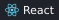

## 🚀 Featured projects

<table>
<tr>
<td width="50%"><a href="https://github.com/jay3490/document-intelligence-rag"><picture><source media="(prefers-color-scheme: dark)" srcset="assets/cards/document-intelligence-rag-dark.svg">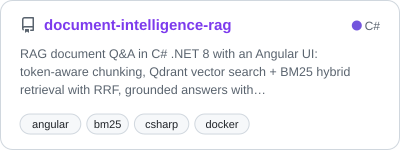</picture></a></td>
<td width="50%"><a href="https://github.com/jay3490/ecommerce-microservices-k8s"><picture><source media="(prefers-color-scheme: dark)" srcset="assets/cards/ecommerce-microservices-k8s-dark.svg">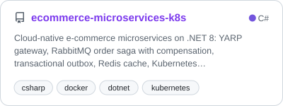</picture></a></td>
</tr>
<tr>
<td width="50%"><a href="https://github.com/jay3490/realtime-location-tracking"><picture><source media="(prefers-color-scheme: dark)" srcset="assets/cards/realtime-location-tracking-dark.svg">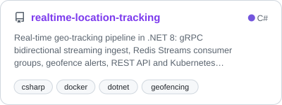</picture></a></td>
<td width="50%"><a href="https://github.com/jay3490/realtime-chat-signalr"><picture><source media="(prefers-color-scheme: dark)" srcset="assets/cards/realtime-chat-signalr-dark.svg">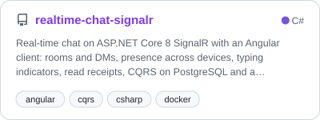</picture></a></td>
</tr>
<tr>
<td width="50%"><a href="https://github.com/jay3490/llm-gateway-dotnet"><picture><source media="(prefers-color-scheme: dark)" srcset="assets/cards/llm-gateway-dotnet-dark.svg">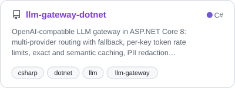</picture></a></td>
<td width="50%"><a href="https://github.com/jay3490/mcp-server-dotnet"><picture><source media="(prefers-color-scheme: dark)" srcset="assets/cards/mcp-server-dotnet-dark.svg">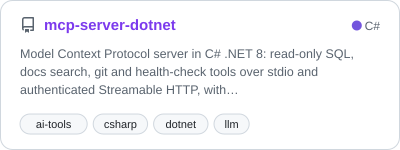</picture></a></td>
</tr>
<tr>
<td width="50%"><a href="https://github.com/jay3490/semantic-kernel-agent"><picture><source media="(prefers-color-scheme: dark)" srcset="assets/cards/semantic-kernel-agent-dark.svg">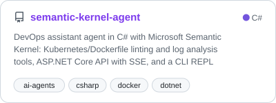</picture></a></td>
<td width="50%"><a href="https://github.com/jay3490/langchain-rag-service"><picture><source media="(prefers-color-scheme: dark)" srcset="assets/cards/langchain-rag-service-dark.svg">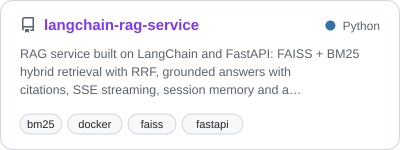</picture></a></td>
</tr>
<tr>
<td width="50%"><a href="https://github.com/jay3490/langgraph-support-agent"><picture><source media="(prefers-color-scheme: dark)" srcset="assets/cards/langgraph-support-agent-dark.svg">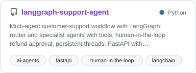</picture></a></td>
<td width="50%"><a href="https://github.com/jay3490/rag-eval-harness"><picture><source media="(prefers-color-scheme: dark)" srcset="assets/cards/rag-eval-harness-dark.svg">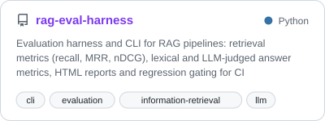</picture></a></td>
</tr>
</table>

## 📊 GitHub stats

<picture><source media="(prefers-color-scheme: dark)" srcset="assets/activity-dark.svg"></picture>
<picture><source media="(prefers-color-scheme: dark)" srcset="assets/languages-dark.svg"></picture>

### 🤝 Let's connect

I'm always happy to talk about distributed systems, .NET, or building with LLMs. 
📫 **[jayahir1419@gmail.com](mailto:jayahir1419@gmail.com)** · 💼 **[LinkedIn](https://www.linkedin.com/in/jayahir-fullstackdeveloper/)** · 🌐 **[Portfolio](https://jay-ahir.pages.dev/)**

